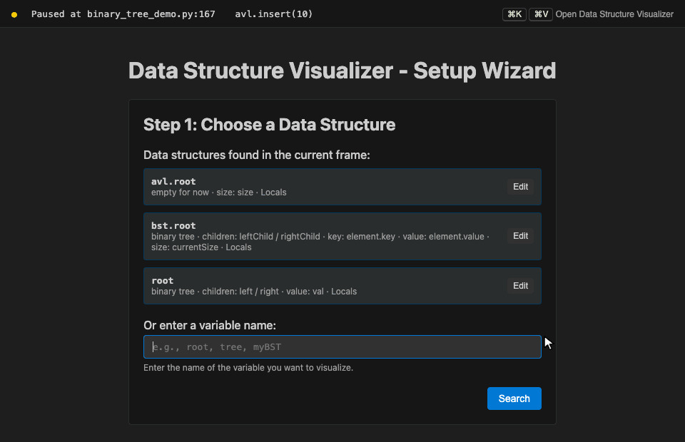
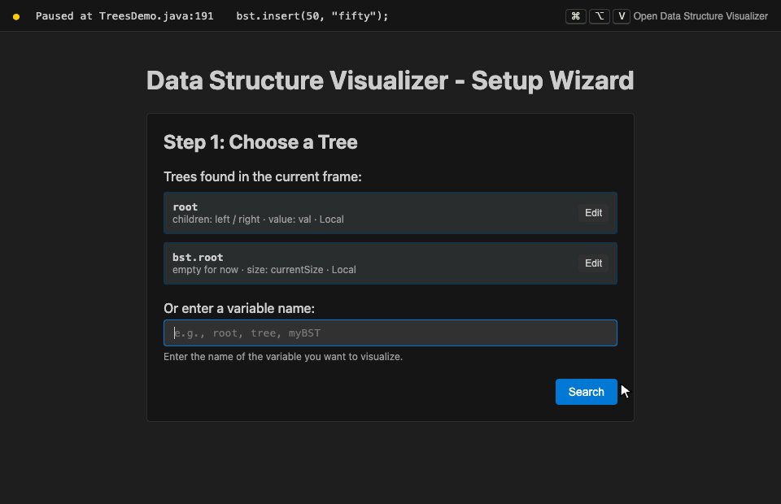
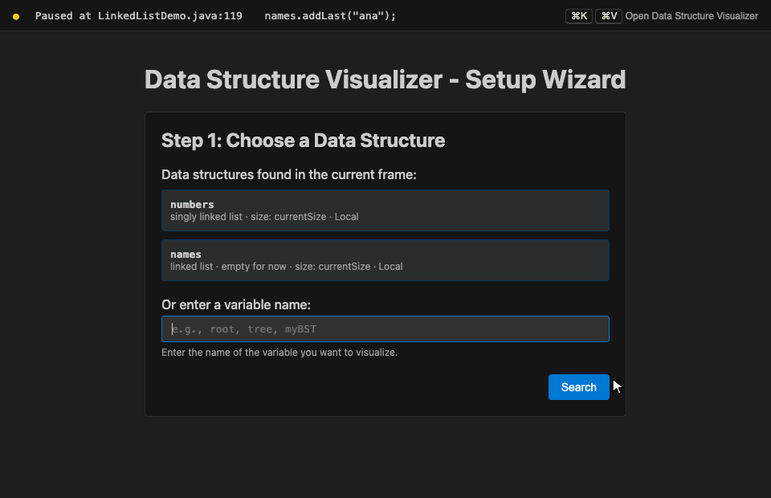
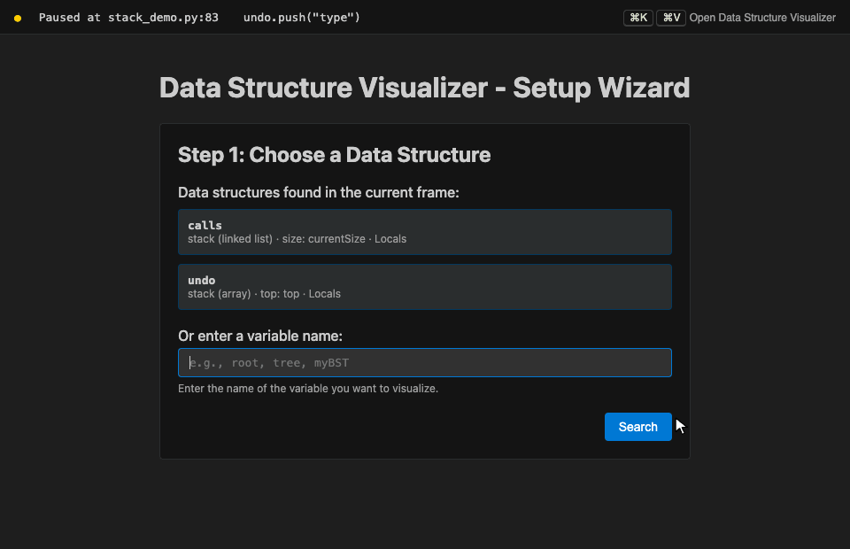
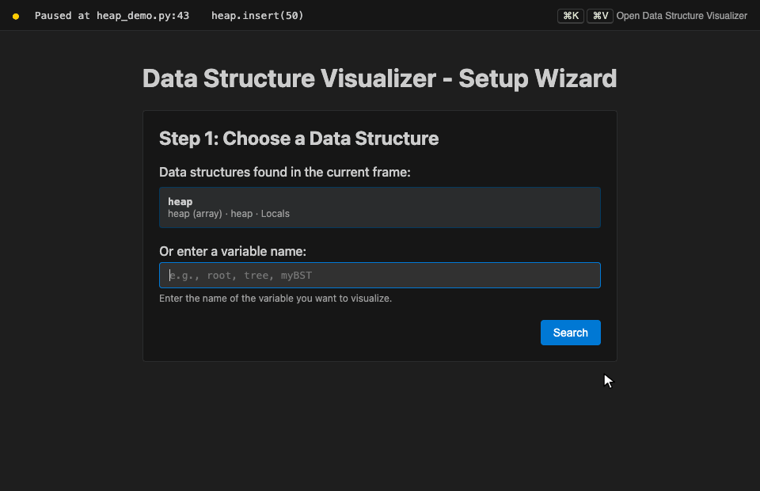
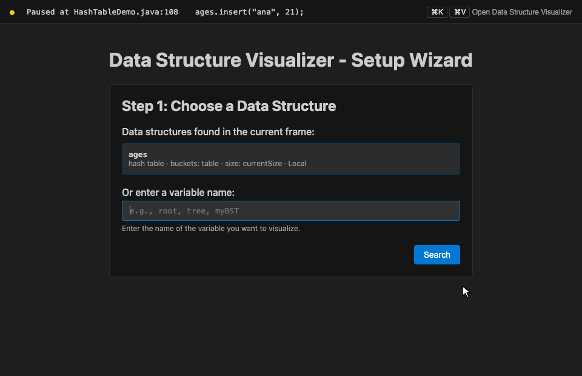
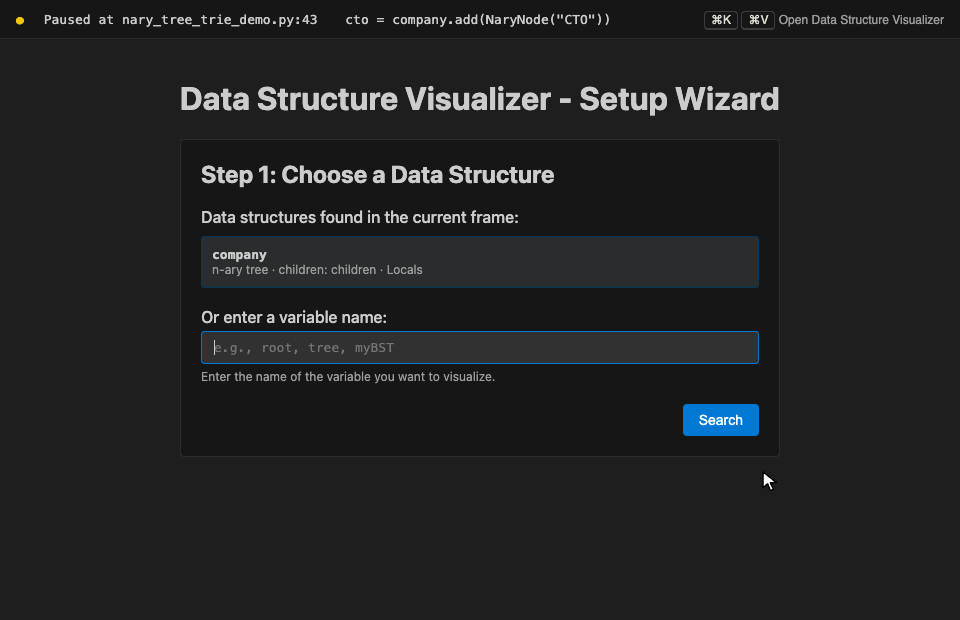
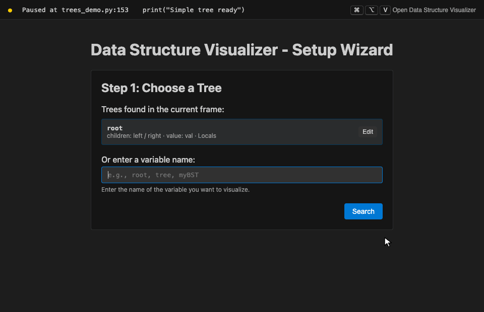

# Debug Data Structures Visualizer

See your data structures while you debug. Stop at a breakpoint and the extension draws your binary trees, linked lists, stacks, queues, heaps, hash tables, n-ary trees and tries, then redraws them at every step. Made for data structures courses, in Python and Java.

## ✨ Features

- 🔎 **Automatic detection**: lists the data structures in the current frame (`root`, `bst.root`, `self.root`, `this.root`, `queue`...) so you open one with a click, no configuration
- 🌳 **Binary trees**: BSTs, AVL trees, any node with left/right children
- 🔗 **Linked lists**: singly and doubly linked, with head / tail and next / previous pointers
- 📚 **Stacks and queues**: on top of a list, or in an array (circular queues included) with top / front / rear markers
- ⛰️ **Heaps**: the array and the tree it encodes, side by side
- #️⃣ **Hash tables**: buckets with their separate chains
- 🌲 **N-ary trees and tries**: nodes with a list, array or dictionary of children
- 🔄 **Live**: redrawn every time the debugger stops, whether you step from the panel, the toolbar or a shortcut
- 🎮 **Debug controls in the panel**: Step Over, Step Into, Step Out, Continue
- 🖱️ **Interactive**: click any node, box or cell to see its fields; drag tree nodes around
- 🐍☕ **Python and Java**, tested with the debuggers VS Code uses for both

## 🚀 Quick Start

1. **Set a breakpoint** where your data structure exists, and start debugging (F5).
2. **When the program stops**, open the visualizer:
   - `Cmd+K Cmd+V` (Mac) or `Ctrl+K Ctrl+V` (Windows/Linux)
   - the **Visualize** button in the status bar
   - the graph icon at the top right of the editor, or in the debug toolbar
   - right-click a variable in the **Variables** view → **Visualize Data Structure** (opens it directly)
3. **Click a structure** in the list of structures found in the current frame.
4. **Step through your code** with **Step Over** in the panel (or F10) and watch the structure change.

No breakpoint yet? Try the [examples](#-try-it-with-the-examples): one folder per data structure, in Python and Java.

## 🧱 Supported Data Structures

Each structure is detected from its field names, the way they are written in courses and textbooks (in any letter case). Values are read from fields such as `element`, `val`, `value`, `data`, `item` or `key`, including entries that hold a key and a value.

| Structure | Detected from | Drawn as |
|---|---|---|
| Binary tree | `left` / `right` (or `leftChild` / `rightChild`, `lchild` / `rchild`), often under a `root` field | Tree of circles, keys inside |
| Linked list | `next`, and `prev` / `previous` for doubly linked lists, often under `head` (and `tail`) | Boxes with pointer cells and arrows |
| Stack, queue on a list | A class called `...Stack` or `...Queue` holding a list (e.g. `StackInList.list.head`) | List labelled `top`, or `front` / `rear` |
| Stack in an array | An array plus an int `top`, a class called `...Stack`, or a Python list named `stack` | Vertical array with a `top` marker |
| Queue in an array | An array plus `front` / `rear` (circular queues), or a class called `...Queue` | Array with `front` / `rear` markers |
| Heap | An array in a class called `...Heap` / `...PriorityQueue`, or a list named `heap` | The array and the tree it encodes |
| Hash table | An array called `table` / `buckets` (or in a `...Hash...` class) of lists, chains or `(key, value)` pairs | Buckets with their chains |
| N-ary tree, trie | A `children` list, array or dictionary (tries with 26 children per node get their letters from the position) | Tree; in tries, word endings get a white border |

### Binary trees

Plain trees, BSTs and AVL trees. Textbook trees work too, like this Java BST whose nodes hold an `element` entry with a key and a value, linked with `leftChild` / `rightChild`:

### Linked lists

### Stacks and queues

### Heaps

### Hash tables

### N-ary trees and tries

An n-ary tree lets each node have any number of children. A trie is an n-ary tree of letters that stores words: words with the same beginning share the same path.

## 🧪 Try It with the Examples

The [`examples`](examples/) folder has one folder per data structure, each with a Python program, a Java program and a README listing what you should see at every breakpoint:

| Folder | Structures |
|---|---|
| [01-binary-tree](examples/01-binary-tree/) | Simple binary tree, BST with key/value entries, AVL tree with rotations |
| [02-linked-list](examples/02-linked-list/) | Singly linked list, doubly linked list |
| [03-stack](examples/03-stack/) | Stack on a list, stack in an array |
| [04-queue](examples/04-queue/) | Queue on a list, circular queue in an array |
| [05-heap](examples/05-heap/) | Min-heap in an array |
| [06-hash-table](examples/06-hash-table/) | Hash table with separate chaining |
| [07-nary-tree-trie](examples/07-nary-tree-trie/) | N-ary tree, trie |

[Download the repository](https://github.com/MCCProgrammer/debug-dataStructures-visualizer-extension/archive/refs/heads/main.zip), open the `examples` folder in VS Code, set breakpoints on the lines marked `BREAKPOINT` and press F5 with **Python: current file** or **Java: current file**.

## 🖱️ In the Panel

- **Click** a node, list box, array cell or hash table entry to see its fields. Click anywhere else to close the details.
- **Drag** tree nodes to make room; the links follow.
- **Step Over / Step Into / Step Out / Continue** control the debugger from the panel.
- **CurrentSize** shows the size field of the structure, when it has one.
- **Refresh** redraws the structure (`Cmd+Shift+R` / `Ctrl+Shift+R` when the panel is focused).
- **Back** returns to the wizard; **Add Another Visualization** opens a second panel, for example to watch two structures at once.
- Large structures are scaled down to fit (to 50% at most), then the panel scrolls.

## 🛠️ Setting the Paths Yourself

If your binary tree uses unusual field names, enter the variable name in the wizard, choose **Binary Tree (set each path yourself)** and fill in the paths to the tree root, the left and right children, the key, the value and the size. **Check** shows the value each path points to.

For every other structure, keep **Detect automatically** in step 2.

## ⚙️ Settings

| Setting | Default | Description |
|---|---|---|
| `dataStructuresVisualizer.maxDepth` | `20` | Maximum depth drawn for trees (1 to 100) |
| `dataStructuresVisualizer.treeOrientation` | `horizontal` | `horizontal` (left to right) or `vertical` (top to bottom) |
| `dataStructuresVisualizer.showDebugControls` | `true` | Show the Step Over / Step Into / Step Out / Continue buttons in the panel |
| `dataStructuresVisualizer.autoRefreshInterval` | `300` | Delay in milliseconds before redrawing after the debugger stops |

## ⌨️ Keyboard Shortcuts

| Shortcut | Action |
|---|---|
| `Cmd+K Cmd+V` / `Ctrl+K Ctrl+V` | Open Data Structure Visualizer (while debugging) |
| `Cmd+Shift+R` / `Ctrl+Shift+R` | Refresh the visualization (when the panel is focused) |

Change them in **Keyboard Shortcuts** (`Cmd+K Cmd+S` / `Ctrl+K Ctrl+S`) by searching for "Data Structure".

## 🌐 Languages

| Language | Debugger | Status |
|---|---|---|
| Python | Python Debugger (debugpy) | Tested |
| Java | Debugger for Java | Tested |
| JavaScript / TypeScript, C#, Kotlin | Their usual VS Code debuggers | Should work (fields are read the same way), not tested yet |
| C / C++, Rust | | Not supported yet |

## 🔧 Requirements

- VS Code 1.85 or later, or an editor based on it (Cursor, VSCodium, Windsurf...)
- A debugger for your language: **Python Debugger** for Python, **Extension Pack for Java** for Java

## 🐛 Troubleshooting

**"No active debug session"**: start debugging first (F5), with a breakpoint where your structure exists.

**"The program is still running"**: the debugger has not stopped yet. Set a breakpoint and wait until the line is highlighted.

**My structure is not listed**: it has to exist in the frame where the program stopped (a local variable, or a field of `self` / `this`). Type its name in the wizard, press **Search** and keep **Detect automatically**. For a binary tree with unusual field names, set the paths yourself.

**The tree is cut**: trees deeper than `dataStructuresVisualizer.maxDepth` (20 by default) are cut at that depth.

Found a bug or have an idea? [Open an issue](https://github.com/MCCProgrammer/debug-dataStructures-visualizer-extension/issues) or write to [contact@mccprogrammer.com](mailto:contact@mccprogrammer.com).

## 🗺️ Roadmap

- Graphs (adjacency lists and matrices)
- Red-black trees with their colours, AVL trees with balance factors
- Export a visualization as PNG or SVG

## ❤️ Support

If the extension helps you, a [rating on the Marketplace](https://marketplace.visualstudio.com/items?itemName=MCCProgrammer.debug-dataStructures-visualizer-extension&ssr=false#review-details) or a coffee on [Ko-fi](https://ko-fi.com/mccprogrammer) makes a big difference.

## 📬 Contact

Questions, feedback or ideas: [contact@mccprogrammer.com](mailto:contact@mccprogrammer.com).

## 🤝 Contributing

Contributions are welcome. Open an issue or a pull request on [GitHub](https://github.com/MCCProgrammer/debug-dataStructures-visualizer-extension).

## 📄 License

MIT

## 🙏 Acknowledgments

- [D3.js](https://d3js.org/) for the drawings (bundled with the extension, so it works offline)
- The VS Code Debug Adapter Protocol, which lets the extension read variables from any debugger
